# ios-secure-vault

[](https://github.com/andreccls/ios-secure-vault/actions/workflows/ci.yml)
[](https://swift.org)
[](https://developer.apple.com/xcode/swiftui/)
[-000000)](project.yml)
[](docs/TESTING.md)
[-brightgreen)](docs/TESTING.md#cobertura)
[](LICENSE)

> ⚠️ **PROJETO DE EXEMPLO (reference / sample) — NÃO É UM PRODUTO.**
> Existe para demonstrar criptografia no cliente, arquitetura modular e testes em Swift moderno.
>
> 🔐 **ESTE COFRE NÃO FOI AUDITADO por terceiros e NÃO DEVE guardar segredos reais** (senhas, chaves, códigos 2FA da sua vida de verdade).
> Use só dados fictícios. Os limites honestos estão em [docs/THREAT_MODEL.md](docs/THREAT_MODEL.md) e em [Limitações](#limitações-conhecidas).

> 🇬🇧 English summary: [README.en.md](README.en.md).

## O que é

App iOS (**Swift 6, SwiftUI, Observation, iOS 17+**) que guarda, criptografados no aparelho:

- **Senhas** (título, usuário, senha, URL, notas) com **gerador de senha forte configurável** e indicador de força.
- **Autenticadores TOTP** (RFC 6238; segredo base32 ou URI `otpauth://`) com código de 6 dígitos, contagem regressiva e copiar.
- **Chaves de autenticação** (API key, chave SSH, token, códigos de recuperação), mascaradas com "revelar" sob demanda.
- Busca (em memória), favoritos, edição, **exclusão com confirmação**.
- **Senha mestra + Face ID/Touch ID opcional**, **auto-lock** (background imediato e inatividade configurável), **tela de privacidade** no seletor de apps, clipboard com **expiração automática** (30 s, `localOnly`), backoff crescente após senhas erradas, **backup criptografado** (exportar/importar).

Zero dependências de terceiros: só frameworks da Apple (CryptoKit, CommonCrypto, LocalAuthentication, Security).

## Telas

Capturas **reais** do app no simulador (iPhone 17 Pro, iOS 26.5), geradas por `make screenshots` com **dados 100% fictícios** (`example.com`, segredo TOTP de teste da RFC 6238).

| | | | |
|---|---|---|---|
| 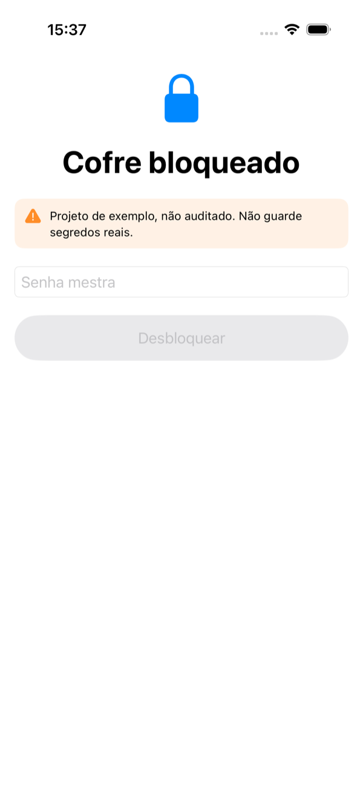<br/>**Desbloqueio** | 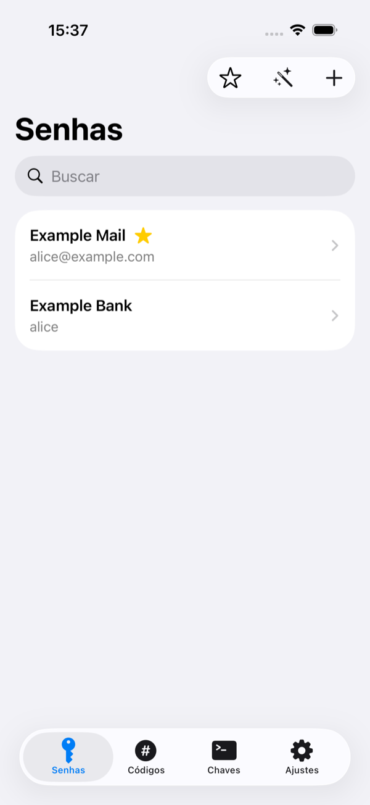<br/>**Lista**, com favorito | 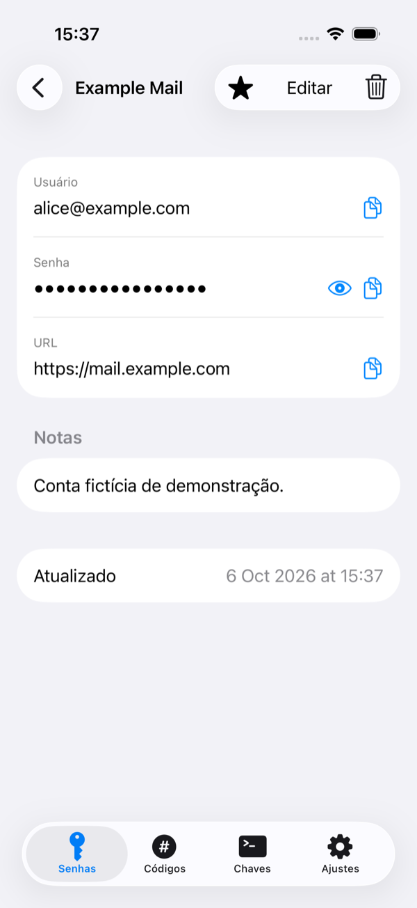<br/>**Detalhe**, mascarado | 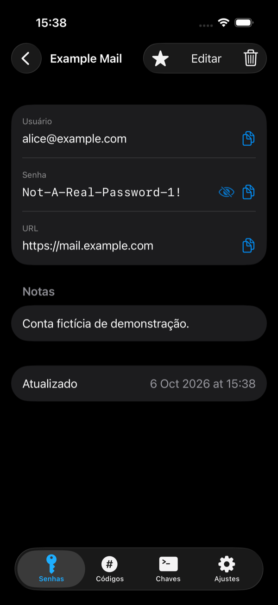<br/>**Revelado** (escuro) |
| 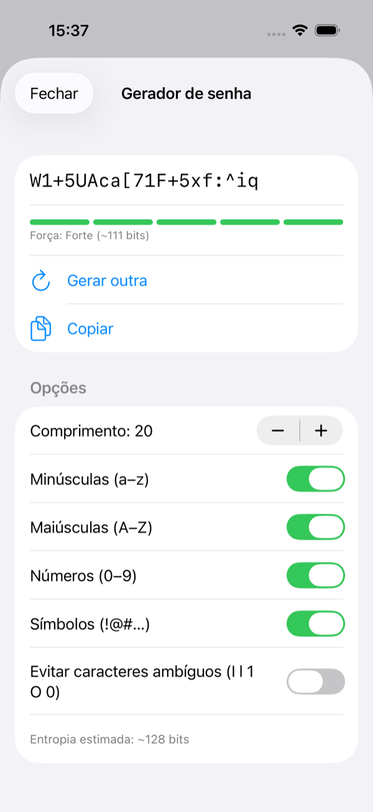<br/>**Gerador** + força | 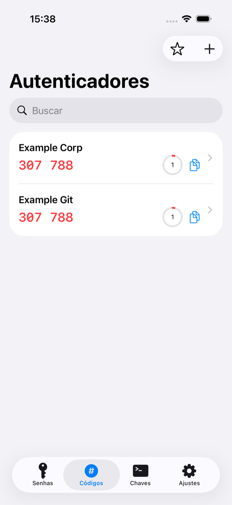<br/>**TOTP** com contagem | 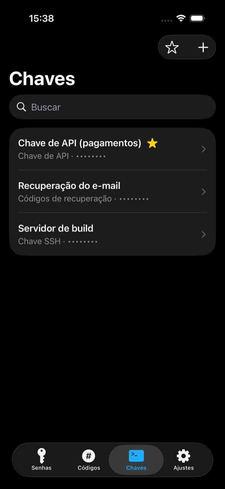<br/>**Chaves** (escuro) | 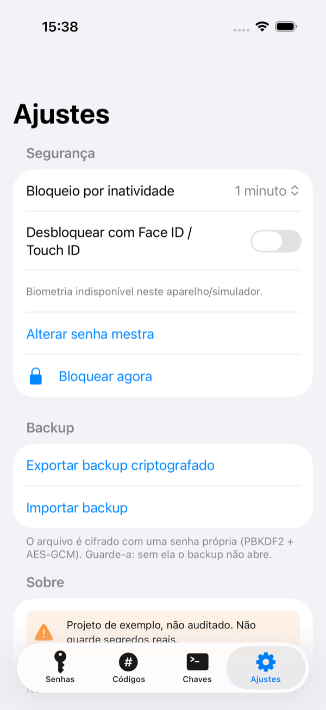<br/>**Ajustes** |
| 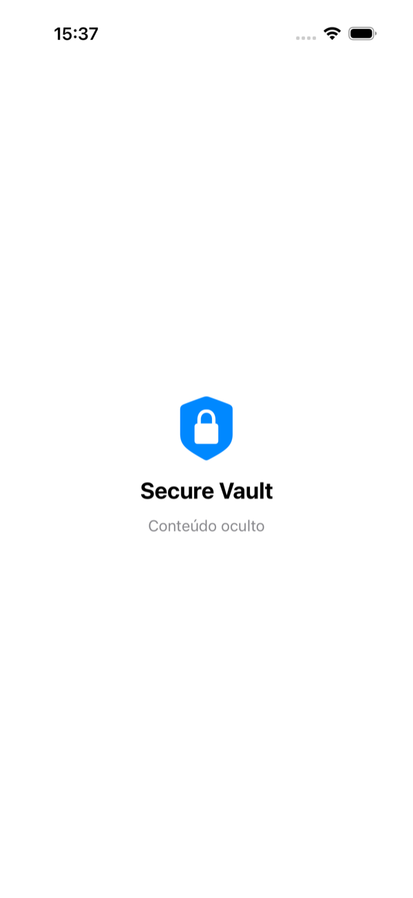<br/>**Tela de privacidade** | 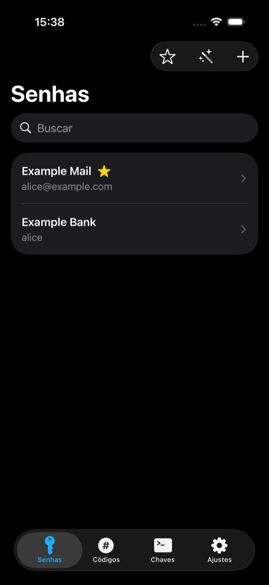<br/>Lista (escuro) | 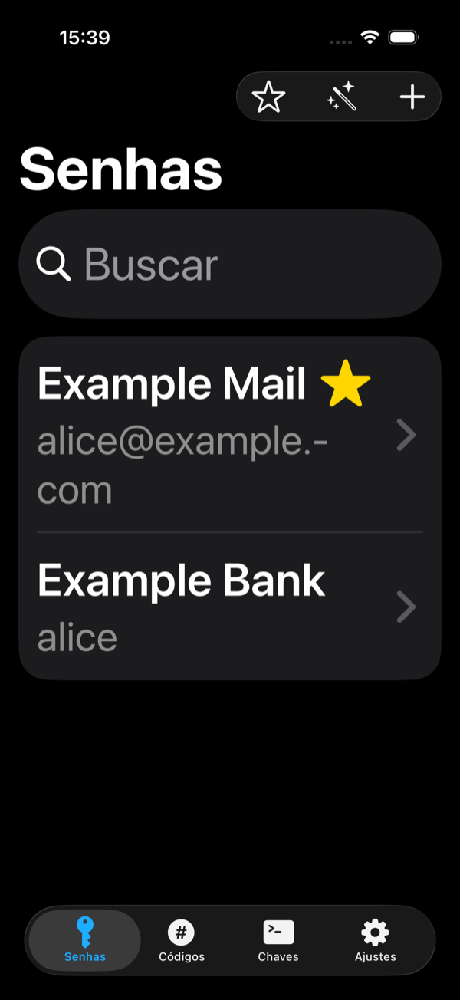<br/>**Dynamic Type XXL** | 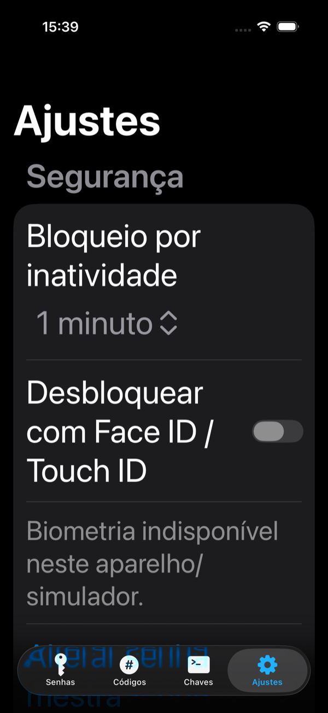<br/>Ajustes, XXL |

Também há `-dark` de todas as telas em [docs/images](docs/images). A tela de privacidade é capturada com um gancho de DEBUG que a força na tela (o instantâneo do seletor de apps real não é capturável por XCUITest).

## Arquitetura

Detalhes, fluxos de desbloqueio/criptografia em Mermaid e o passo a passo para **adicionar um novo tipo de item** em [docs/ARCHITECTURE.md](docs/ARCHITECTURE.md).

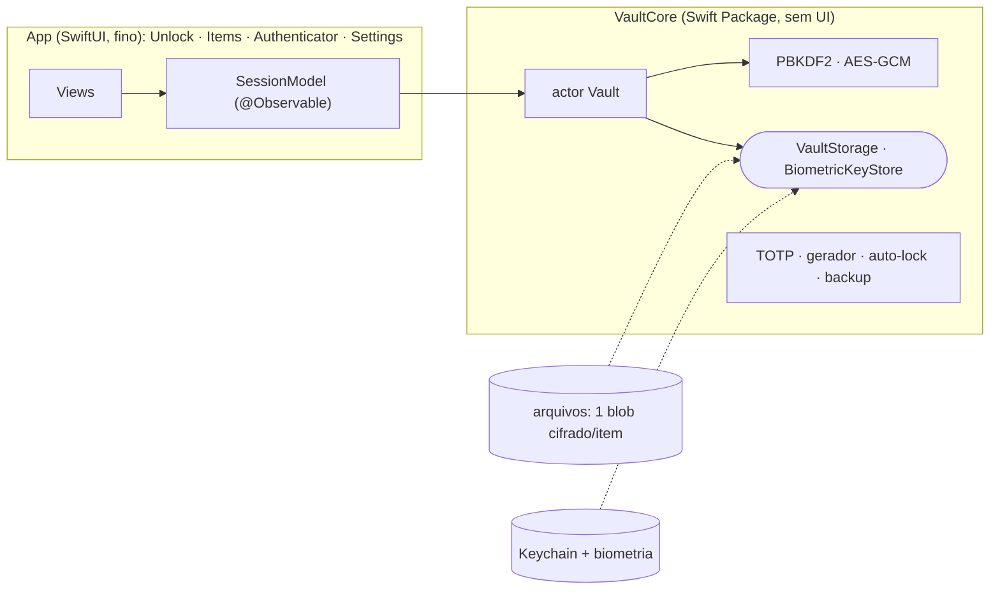

Regra de dependência **`App → VaultCore`** (nunca o contrário; o pacote não enxerga o app). Hierarquia de chaves: **senha mestra → PBKDF2 → KEK → desembrulha a DEK aleatória → AES-256-GCM por item** (AAD = id do item).

### Princípio → código

| Princípio | Onde |
|---|---|
| Nunca guardar a senha mestra; KDF forte com parâmetros no header | `Crypto/KeyDerivation.swift` (PBKDF2-SHA256, 600k, salt 16 B) · [ADR 0003](docs/adr/0003-kdf-pbkdf2.md) |
| Cifra autenticada, nonce único, AAD amarra o blob ao item | `Crypto/AESGCMCipher.swift`, `Vault.itemAAD` · [ADR 0004](docs/adr/0004-aes-gcm-dek-kek.md) |
| Trocar a senha sem recifrar tudo (DEK/KEK) | `Vault.changeMasterPassword` |
| Nada sensível em repouso (nem o título) | `Vault/FileVaultStorage.swift` · [ADR 0006](docs/adr/0006-blobs-cifrados-em-arquivos.md) |
| Biometria só desbloqueia uma chave protegida pelo Keychain | `Security/KeychainBiometricKeyStore.swift` · [ADR 0005](docs/adr/0005-keychain-biometria.md) |
| Limite de tentativas (backoff) | `Vault/AttemptPolicy.swift` |
| Auto-lock testável (relógio injetado) | `Security/AutoLock.swift`, `SessionModel.checkInactivity` |
| Sem UI no domínio (SRP, dependency rule) | `VaultCore/Package.swift` · [ADR 0002](docs/adr/0002-vaultcore-package.md) |
| DI por protocolos, raiz de composição única | `App/Support/AppComposition.swift` |
| Telas finas, regra em tipos testáveis | `ItemDraft`, `GeneratorModel`, `ItemFilter` · [ADR 0001](docs/adr/0001-swiftui-observation.md) |
| KISS/YAGNI | sem SwiftData, sem libs, sem DI framework, sem Argon2 caseiro |

## Como buildar, rodar e testar

Pré-requisitos (macOS Apple Silicon): **Xcode 26** completo (`xcode-select -p` deve apontar para ele, ou `export DEVELOPER_DIR=/Applications/Xcode.app/Contents/Developer`) e **XcodeGen** (`brew install xcodegen`). O `.xcodeproj` é **gerado** a partir de `project.yml` (e ignorado no git). Sem Team/assinatura: o build é para simulador com `CODE_SIGNING_ALLOWED=NO`.

```bash
make build         # gera o projeto e compila para o simulador
make test          # swift test (VaultCore) + testes do app no simulador
make test-ui       # XCUITests no simulador (fora do CI)
make lint          # swift-format --strict (vem com o Xcode)
make coverage      # cobertura de linhas do VaultCore
make run           # build + instala + abre no simulador
make screenshots   # regrava docs/images (claro, escuro, XXL)
make clean
```
Variáveis: `UDID=<simulador>` (padrão iPhone 17 Pro) e `DD=<derivedDataPath>` (padrão `build/`, ignorado).

## Testes e qualidade

Medidos em 2026-10-06 (detalhes em [docs/TESTING.md](docs/TESTING.md)):

| Verificação | Resultado |
|---|---|
| VaultCore (`swift test`, Swift Testing) | **84 testes verdes** (vetores PBKDF2-SHA256; **vetores oficiais RFC 6238** SHA1/256/512; adulteração do blob em cada byte; 5 000 nonces distintos; backoff; wrap/unwrap; backup…) |
| Testes do app (simulador) | **22 verdes** (view-models com fakes, relógio injetado) |
| UI tests (XCUITest, simulador) | **6 verdes**: criar cofre, adicionar senha, adicionar autenticador, bloquear/desbloquear, excluir com confirmação, **auto-lock ao ir para background**, segredo mascarado |
| Cobertura VaultCore | **99,5%** das linhas (547/550) sem o arquivo do Keychain; **89,7%** (547/610) incluindo-o; crypto e TOTP puro 100% |
| Cobertura do app (unit + UI) | 76,1% (1 785/2 346): `SessionModel` 99%, views 56–93% |
| Build / lint | Swift 6 strict concurrency, avisos como erro, **0 avisos**; `swift-format --strict` limpo |
| Execução no simulador | sem crash; telas verificadas em claro/escuro e com **Dynamic Type XXL** |
| Clone limpo | build + 84 testes do pacote + 22 do app + 6 UI + lint **passam num clone novo** (sem `build/`, `DerivedData` novo, 0 avisos de compilação) |

Os UI tests **não rodam no CI** (boot/teclado do simulador instáveis em runner hospedado): `make test-ui`.

## Limitações conhecidas

- **Não auditado e não é para segredos reais.** Sem pentest, sem revisão criptográfica externa.
- **PBKDF2, não Argon2id:** a Apple não oferece Argon2/scrypt; PBKDF2 não é memory-hard (ADR 0003).
- **Face ID e Secure Enclave NÃO foram validados** — o simulador não tem biometria real nem Secure Enclave. `KeychainBiometricKeyStore` (`.biometryCurrentSet`, `ThisDeviceOnly`) nunca rodou fora do caminho "indisponível" e não tem teste automatizado; só a lógica de fallback ao redor é testada (com fake). Além disso a DEK guardada **não é uma chave do Secure Enclave** (ADR 0005).
- **Memória:** `String`/`SymmetricKey` do Swift não são zerados; só os buffers de bytes do KDF são (`memset_s`). Um dump do processo desbloqueado revela tudo.
- **Metadados em claro:** nº de itens, ids e datas de modificação dos arquivos.
- **Backoff só protege a UI**, não um ataque offline sobre os arquivos.
- **Sem recuperação** da senha mestra. Sem sincronização, sem iCloud, sem AutoFill do sistema, sem importar de outros gerenciadores.
- **Clipboard:** expira em 30 s, mas outros apps podem lê-lo nesse intervalo.
- **Tela de privacidade é opaca** (não um blur) por escolha: é mais seguro.
- **Backup/importação** e "alterar senha mestra" têm testes unitários, mas **não têm UI test**.
- **UI só em português**; não verificado: VoiceOver em aparelho real, contraste medido por ferramenta, iPad/paisagem, aparelho físico, o workflow de CI no GitHub (ainda não rodou lá).
- A detecção de atividade por toque e a digitação no editor são heurísticas; ficar só lendo a tela sem tocar bloqueia após o prazo.

## Próximos passos (YAGNI, **não implementado**)

- Argon2id (dependência auditada ou implementação própria revisada) com migração do header.
- Chave EC no Secure Enclave + ECIES para embrulhar a DEK; teste em aparelho real.
- AutoFill de credenciais (extensão), importação CSV, relatório de senhas fracas/reutilizadas, câmera para QR de `otpauth://`, HOTP.
- Zerar segredos com buffers próprios (`Data`/`UnsafeMutableRawBufferPointer`) em vez de `String`; localização (en).
- Auditoria externa e fuzzing do parser de `otpauth://`.

## Documentação

[ARCHITECTURE](docs/ARCHITECTURE.md) · [THREAT_MODEL](docs/THREAT_MODEL.md) · [TESTING](docs/TESTING.md) · ADRs:
[0001 SwiftUI+Observation](docs/adr/0001-swiftui-observation.md) ·
[0002 VaultCore](docs/adr/0002-vaultcore-package.md) ·
[0003 KDF](docs/adr/0003-kdf-pbkdf2.md) ·
[0004 AES-GCM DEK/KEK](docs/adr/0004-aes-gcm-dek-kek.md) ·
[0005 Keychain e biometria](docs/adr/0005-keychain-biometria.md) ·
[0006 blobs em arquivos](docs/adr/0006-blobs-cifrados-em-arquivos.md) ·
[0007 testes e ferramentas](docs/adr/0007-estrategia-de-testes-e-ferramentas.md)

## Licença

[MIT](LICENSE) © André Coura
