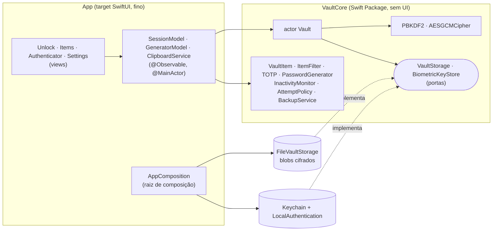
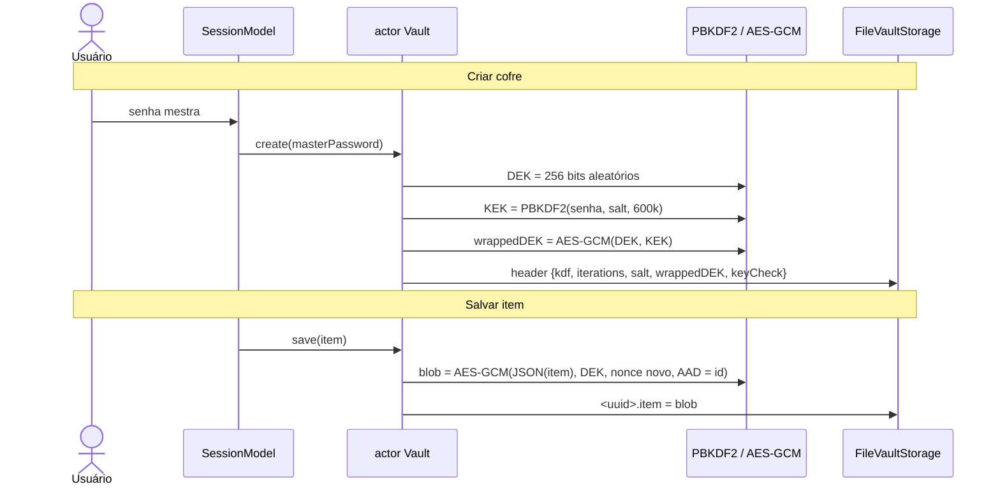

# Arquitetura

> Projeto de **exemplo**, não auditado. Não guarde segredos reais (ver [THREAT_MODEL.md](THREAT_MODEL.md)).

## Módulos e regra de dependência



`App → VaultCore`, nunca o contrário (ver [ADR 0002](adr/0002-vaultcore-package.md)). Só `AppComposition` conhece as implementações concretas; o resto depende de protocolos. Pastas do app por feature: `App/Unlock`, `App/Items`, `App/Authenticator`, `App/Settings`, `App/Session`, `App/Support`.

## Hierarquia de chaves e criptografia



## Fluxo de desbloqueio

```mermaid
sequenceDiagram
    actor U as Usuário
    participant S as SessionModel
    participant V as actor Vault
    participant B as BiometricKeyStore
    participant F as Storage
    alt senha mestra
        U->>S: senha
        S->>V: unlock(masterPassword)
        V->>F: attempts.json (backoff?)
        alt em atraso
            V-->>S: throttled(retryAfter)
        else
            V->>V: KEK = PBKDF2(senha, salt do header)
            V->>V: abrir wrappedDEK (falha = senha errada, grava tentativa)
            V-->>S: DEK em memória; items() decifra os blobs
        end
    else Face ID / Touch ID
        S->>B: loadKey (prompt biométrico)
        B-->>S: DEK
        S->>V: unlock(key) — valida com keyCheck
    end
    Note over S,V: lock(): descarta a DEK e os itens decifrados (background imediato ou inatividade)
```

## Bloqueio e privacidade

- `RootView` observa `scenePhase`: `.background` chama `lock()` na hora; fora de `.active` mostra a `PrivacyShield` (cobertor opaco, o snapshot do seletor de apps nunca contém segredos).
- Inatividade: `InactivityMonitor` (puro, recebe `now`) + um laço de 1 s; qualquer toque (e a digitação no editor) conta como atividade. Prazos: 30 s, 1, 5, 15 min.
- Clipboard: `UIPasteboard` com `.localOnly` e `.expirationDate` (30 s).

## Como adicionar um novo tipo de item (ex.: "Cartão")

1. **Core:** em `VaultCore/Sources/VaultCore/Domain/VaultItem.swift` crie `CardContent: Codable, Hashable, Sendable`, adicione `case card` em `ItemKind`, `case card(CardContent)` em `ItemContent` (e em `kind`) e os campos pesquisáveis (nunca o segredo) em `ItemFilter.searchableFields`. O compilador aponta todo `switch` não exaustivo.
2. **Teste primeiro:** em `VaultCoreTests` adicione o round-trip do novo tipo (`allThreeKindsRoundTrip`) e a busca.
3. **App:** `ItemKind+UI.swift` (título/ícone), campos em `ItemDraft` (+ `build`/`init(item:)` e seus testes), `ItemEditorView` (seção de campos), `ItemDetailView.content(of:)` (use `FieldRow(isSecret:)` para o que for sensível) e `ItemRow`.
4. **Aba:** inclua `ItemListView(kind: .card)` em `MainTabView`.
Nada muda em crypto, storage ou bloqueio: o item inteiro já é um blob JSON cifrado.

## Limites de memória

Swift não permite zerar `String`/`SymmetricKey`; só os buffers de bytes que o código possui (senha em bytes no PBKDF2, saída do KDF) são zerados com `memset_s`. Os itens decifrados vivem como `String`s no `SessionModel` enquanto desbloqueado e são descartados (sem garantia de apagar a página) ao bloquear.
